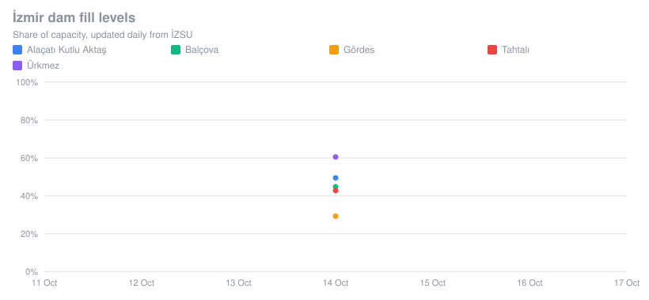
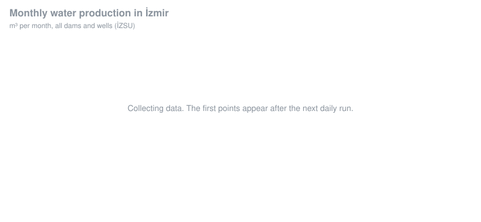
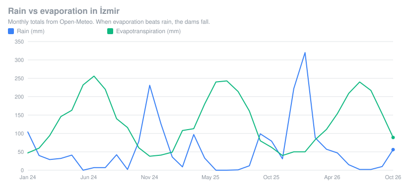
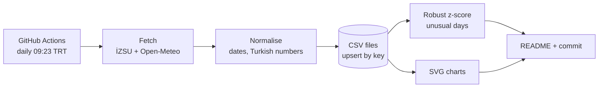

# İzmir Water Watch

[](https://github.com/NyksNightBender/izmir-water-watch/actions/workflows/update.yml)
[](https://github.com/NyksNightBender/izmir-water-watch/actions/workflows/ci.yml)

A small data pipeline that runs every morning on GitHub Actions. It collects İzmir's dam levels, daily water production and weather, stores them as tidy CSV files, flags days when water production looks unusual, and redraws the charts below.

*İzmir'in baraj doluluk oranlarını, günlük su üretimini ve hava durumunu her gün otomatik toplayan, olağandışı günleri işaretleyen bir veri hattı.*

It is a companion to my TÜBİTAK 2209-A research project on machine-learning-based early detection of abnormal water consumption. The anomaly flag here uses the same robust z-score baseline as that project, applied to a live city-scale signal.

## Latest

<!-- LATEST:START -->
**Dam levels on 2026-10-14**

| Dam | Fill | 7-day change | Water volume |
| --- | ---: | ---: | ---: |
| Ürkmez | 60.5% | – | 5.00 million m³ |
| Alaçatı Kutlu Aktaş | 49.4% | – | 8.41 million m³ |
| Balçova | 44.8% | – | 3.55 million m³ |
| Tahtalı | 42.8% | – | 142.32 million m³ |
| Gördes | 29.3% | – | 143.68 million m³ |

**Weather on 2026-11-04:** 15.0–20.3 °C, rain 1.4 mm, evapotranspiration 1.6 mm.

**Unusual days:** collecting history (0 of 15 days needed before flagging starts).
<!-- LATEST:END -->

<p align="center">
  
</p>
<p align="center">
  
</p>
<p align="center">
  
</p>

## How it works



1. **Fetch.** Four sources are requested independently with timeouts and retries, so one API being down does not stop the others.
2. **Normalise.** The İZSU API mixes date formats and Turkish number formats (`1.234,5`), so every value goes through tested parsers. Unexpected shapes fail loudly instead of writing bad rows.
3. **Store.** Rows are upserted by key (`date + dam`, `date + source`, ...) and kept sorted, so each day's commit shows only what changed.
4. **Detect.** Each day's total production is compared with the previous 28 days using a robust z-score, `z = (x − median) / (1.4826 · MAD)`. Days with `|z| ≥ 3.5` are written to `data/anomalies.csv`. Median and MAD are not pulled around by the outliers they are looking for, unlike mean and standard deviation.
5. **Publish.** Charts are plain SVG generated without dependencies, and the commit happens only when the data actually changed.

## Data

| File | Rows | Columns |
| --- | --- | --- |
| [`data/dams.csv`](data/dams.csv) | one per dam per day | `date, dam, fill_pct, volume_m3, usable_capacity_m3, max_capacity_m3, level_m` |
| [`data/production_daily.csv`](data/production_daily.csv) | one per source per day | `date, source_type, source, m3` |
| [`data/production_monthly.csv`](data/production_monthly.csv) | one per source per month | `year, month, source, m3` |
| [`data/weather.csv`](data/weather.csv) | one per day, central İzmir | `date, t_max_c, t_min_c, precip_mm, et0_mm` |
| [`data/anomalies.csv`](data/anomalies.csv) | one per flagged day | `date, metric, value, median, z` |

Values are stored as reported by the source. Weather history is backfilled from January 2024 on the first run.

## Run it locally

Requires Node.js 22.18 or newer (TypeScript runs natively, no build step).

```bash
npm install        # only needed for type checking and tests
npm run update     # fetch today's data and rebuild charts
npm test           # unit tests for parsers, CSV handling and anomaly detection
npm run typecheck
```

## Sources

- **İZSU Genel Müdürlüğü** open web services via İzmir Büyükşehir Belediyesi: dam status, daily production and monthly production by source ([service documentation](https://openfiles.izmir.bel.tr/309436/docs/izsu-WebServisKullanimDokumani_1.0.pdf)). When the dam service is down, the pipeline falls back to the dam table on the [İzmir open data portal](https://acikveri.bizizmir.com/dataset/barajlarin-doluluk-oranlari), which is refreshed less often.
  *Status, November 2026:* the İZSU production endpoints currently return HTTP 500. The pipeline keeps trying every day, reports the failure as a warning on the Actions run, and starts filling `production_*.csv` (and the unusual-day detection) as soon as they come back.
- **[Open-Meteo](https://open-meteo.com/)** forecast and historical weather APIs, licensed CC BY 4.0.

Code is MIT licensed. Data belongs to its publishers.
